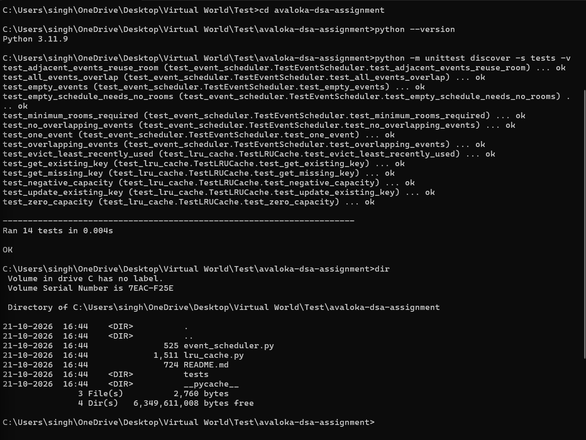

# Avaloka DSA Assignment

Python solutions for two data structures and systems design problems.

## Problems

### 1. LRU Cache
Implemented using a dictionary and a doubly linked list.

- get(key): Returns the value or -1 if the key is missing.
- put(key, value): Adds or updates an entry and removes the least recently used entry when necessary.
- Average time complexity: O(1) for both operations.

### 2. Event Scheduler
Implemented using sorting and a min-heap.

- can_attend_all(events): Checks whether all events can be attended without overlap.
- min_rooms_required(events): Calculates the minimum number of rooms needed.
- Time complexity: O(n log n) for both functions.

## Test Results

All 14 unit tests passed successfully.

## Language

Python 3
